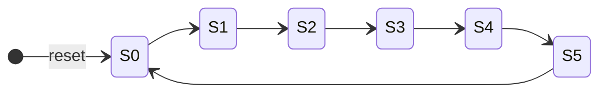
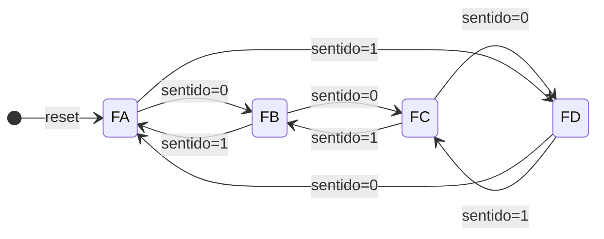
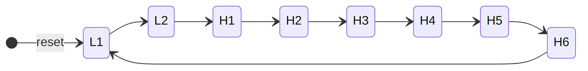
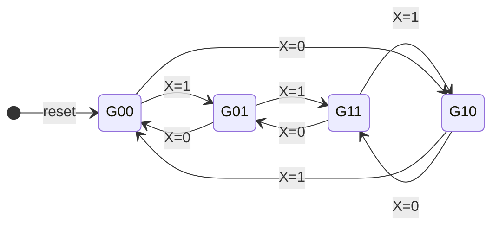
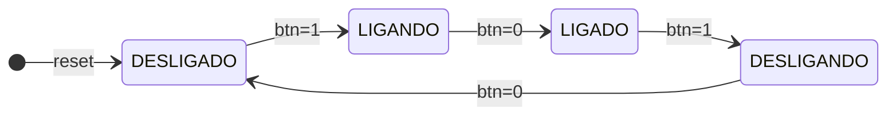
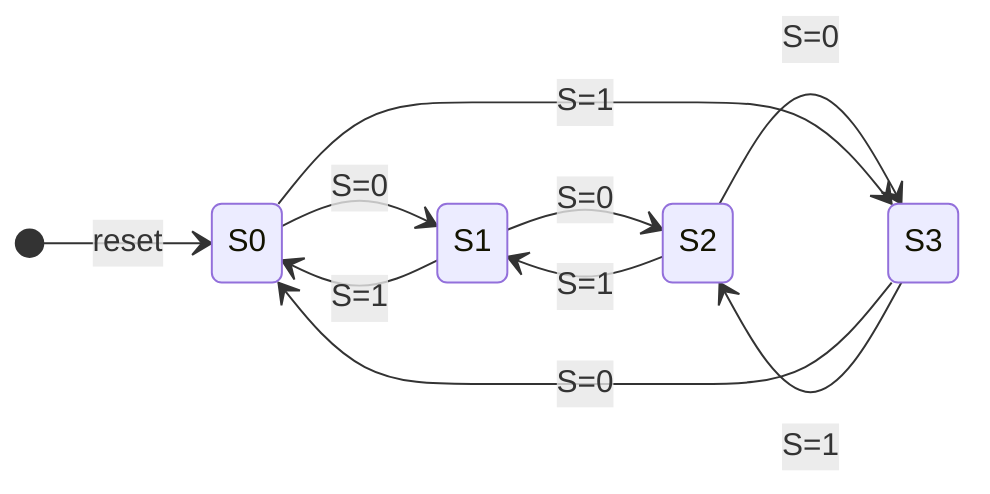
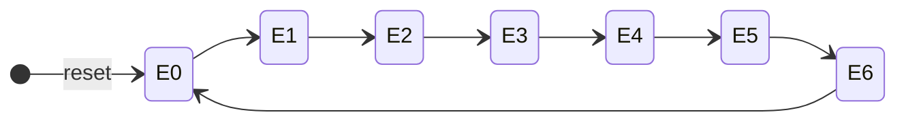

# Explicação das práticas de Máquina de Estados (FSM)

Este documento explica, para todo o grupo, como cada prática foi resolvida e por quê. A ideia é que qualquer integrante consiga apresentar qualquer prática e responder às perguntas do professor.

Práticas por equipe, conforme o slide:

| Equipe | Práticas |
|---|---|
| Giulia | 02, 01, 03 |
| André | 02, 04, 05 |
| Orlando | 02, 06, 07 |

As práticas extras (UART, RFID, processador etc.) **não** estão neste repositório.

## 1. Como o repositório está organizado

Cada pasta `praticaN` é um projeto completo do Quartus Prime 20.1 Lite para a placa DE0-CV (FPGA Cyclone V 5CEBA4F23C7).

| Arquivo | O que é | Vai para a FPGA? |
|---|---|---|
| `praticaN.vhd` | A máquina de estados pedida no slide. **É o arquivo que importa na apresentação.** | Sim |
| `praticaN_de0cv.vhd` | Top-level: liga a FSM ao clock, botões, chaves, LEDs e display da placa. | Sim |
| `div_clk.vhd` | Divisor de clock (50 MHz → clock lento). | Sim |
| `hex7seg.vhd` | Decodificador para o display de 7 segmentos. | Sim |
| `tb_praticaN.vhd` | Testbench: gera as entradas e confere as saídas na simulação. | Não |
| `praticaN.qpf` / `.qsf` | Projeto do Quartus (dispositivo, arquivos, pinos). | — |
| `output_files/praticaN.sof` | Arquivo já compilado, pronto para gravar. | — |

Por que separar a FSM do top-level: a FSM fica exatamente como o enunciado pede (só `clk`, `reset` e os sinais da prática) e pode ser simulada sozinha. Tudo o que é específico da placa fica no top-level.

## 2. Conceitos que aparecem em todas as práticas

### 2.1 Máquina de estados

Uma FSM tem três partes, como no "modelo base" do slide:

- **Registrador de estado:** flip-flops que guardam o estado atual e só mudam na borda de subida do clock.
- **Lógica de próximo estado:** combinacional. Olha o estado atual e as entradas e decide o próximo estado.
- **Lógica de saída:** combinacional. Calcula as saídas.

A diferença entre os dois tipos está na lógica de saída:

| | Moore | Mealy |
|---|---|---|
| A saída depende de | só do estado atual | estado atual **e** entradas |
| Quando a saída muda | só depois de uma borda de clock | na hora em que a entrada muda |
| Práticas | 1, 2, 3, 4, 5 e 6 | 7 |

### 2.2 A "receita" de VHDL usada em todas as FSMs

É o mesmo estilo do exemplo do slide (`TYPE State_type IS (A, B, C)`):

```vhdl
-- 1) Um tipo enumerado dá nome a cada estado
type estado_t is (S0, S1, S2);
signal estado : estado_t;

-- 2) Um processo com clock guarda o estado e decide o próximo
process (clk, reset)
begin
    if reset = '1' then
        estado <= S0;                 -- reset assíncrono: age na hora
    elsif rising_edge(clk) then       -- só muda na borda de subida
        case estado is
            when S0 => estado <= S1;
            ...
        end case;
    end if;
end process;

-- 3) Fora do processo, a saída é calculada a partir do estado (Moore)
q <= "00" when estado = S0 else ...;
```

Pontos que o professor pode perguntar:

- **Por que `reset` está na lista de sensibilidade?** Porque o reset é assíncrono: ele zera a máquina imediatamente, sem esperar o clock. Por isso o `if reset = '1'` vem antes do `elsif rising_edge(clk)`.
- **Quantos flip-flops a FSM usa?** O Quartus escolhe a codificação. Para ver o que ele fez: Tools > Netlist Viewers > State Machine Viewer.
- **Por que a saída fica fora do processo com clock?** Porque ela é combinacional. Se ficasse dentro, viraria um registrador a mais e a saída atrasaria um ciclo.

### 2.3 O divisor de clock (`div_clk.vhd`)

A DE0-CV tem um clock de 50 MHz. Nessa velocidade um contador daria 50 milhões de passos por segundo e os LEDs pareceriam todos acesos. O divisor conta ciclos do clock rápido e inverte a saída a cada `DIVISOR` ciclos:

**f_saída = 50 MHz / (2 × DIVISOR)**

| DIVISOR | Clock da FSM | Usado em |
|---|---|---|
| 25 000 000 | 1 Hz | práticas 1, 4 e 6 |
| 6 250 000 | 4 Hz | práticas 2 e 3 |
| 250 000 | 100 Hz | prática 5 |
| 3 571 | ~7 kHz | prática 7 |

Para mudar a velocidade, troque o número no `generic map` do top-level e recompile.

### 2.4 Detalhes da placa

- **Botões (KEY):** valem `'1'` soltos e `'0'` apertados. As FSMs usam reset ativo em `'1'`, então o top-level faz `reset <= not KEY(0)`. Em todas as práticas, **KEY0 é o reset**.
- **Display (HEX0):** os segmentos acendem com `'0'`. O `hex7seg.vhd` é só uma tabela que converte um número de 4 bits no desenho do dígito.
- **Pinos:** estão no arquivo `.qsf` de cada projeto (linhas `set_location_assignment`). O nome da porta no VHDL (`CLOCK_50`, `KEY`, `SW`, `LEDR`, `HEX0`) tem que ser igual ao do `.qsf`.

### 2.5 Como ler um testbench

O testbench não vira circuito, ele só existe na simulação. Todos seguem o mesmo roteiro:

1. Instancia a FSM com o nome `dut`.
2. Um processo gera o clock com período de 20 ns.
3. Outro processo aplica as entradas e confere as saídas.

Os comandos que aparecem:

| Comando | O que faz |
|---|---|
| `wait for 5 ns;` | Espera um tempo fixo. |
| `wait until rising_edge(clk);` | Espera a próxima borda de subida do clock. |
| `assert q = "001" report "..." severity error;` | Confere a saída. Se estiver errada, imprime a mensagem no ModelSim. |
| `fim <= true;` | Para o clock, e com isso a simulação termina. |

Se a simulação terminar mostrando só `FIM DA SIMULACAO - pratica N` e `Errors: 0`, a FSM passou em todos os testes.

## 3. As práticas

### Prática 1: contador módulo 6 (0 a 5)

**Ideia:** cada valor da contagem é um estado. Não há entrada de controle: a cada clock a máquina vai para o estado seguinte, e depois do 5 volta para o 0.



| Estado | S0 | S1 | S2 | S3 | S4 | S5 |
|---|---|---|---|---|---|---|
| Saída `q` | 000 | 001 | 010 | 011 | 100 | 101 |

- **Tipo:** Moore. A saída `q` é só a tradução do estado para binário.
- **Por que 6 estados e 3 bits:** 3 bits contariam até 7. O que limita a contagem em 5 é a transição `S5 → S0`.
- **Na simulação:** `q` deve mostrar 0, 1, 2, 3, 4, 5, 0, 1... O testbench também aplica um reset no meio da contagem e confere que `q` zera na hora.
- **Na placa:** HEX0 e LEDR2..0 contam de 0 a 5, um passo por segundo. KEY0 zera.

### Prática 2: motor de passo unipolar, modo wave (todas as equipes)

**Ideia:** no modo wave só uma bobina fica energizada por vez. Cada estado é "qual bobina está ligada". A entrada `sentido` escolhe se a máquina anda para a frente ou para trás na sequência.



| Estado | A | B | C | D |
|---|---|---|---|---|
| FA | 1 | 0 | 0 | 0 |
| FB | 0 | 1 | 0 | 0 |
| FC | 0 | 0 | 1 | 0 |
| FD | 0 | 0 | 0 | 1 |

- **Tipo:** Moore. As saídas A, B, C e D dependem só do estado. `sentido` só influencia o próximo estado.
- **Tabela do enunciado:** `reset` volta ao estado inicial (fase A), `clock` define a velocidade (um passo por borda), `sentido = '0'` é horário e `'1'` é anti-horário.
- **Na simulação:** as formas de onda de A, B, C e D ficam em "escadinha", igual à figura "Modo Wave" do slide. Depois de trocar `sentido`, a escadinha inverte.
- **Na placa:** LEDR3..0 mostram um LED "andando" a 4 passos por segundo. SW0 inverte o sentido.
- **Para ligar um motor de verdade:** as fases também saem em GPIO_0[3..0]. É obrigatório usar um driver (por exemplo ULN2003) entre a placa e o motor, porque o pino do FPGA não aguenta a corrente da bobina. Para o motor girar de forma contínua, aumente o clock (por exemplo `DIVISOR => 125_000`, que dá 200 passos/s). **Essa ligação com motor real não foi testada.**

### Prática 3: gerador de sinal (2T0 baixo, 6T0 alto)

**Ideia:** o período completo tem 2 + 6 = 8 ciclos de clock, então a máquina tem 8 estados em fila. Os próprios estados "contam o tempo": a saída fica baixa nos dois primeiros e alta nos outros seis.



| Estado | L1 | L2 | H1 | H2 | H3 | H4 | H5 | H6 |
|---|---|---|---|---|---|---|---|---|
| Saída `y` | 0 | 0 | 1 | 1 | 1 | 1 | 1 | 1 |

- **Tipo:** Moore.
- **Na simulação:** com clock de 20 ns, `y` fica 40 ns em baixo e 120 ns em alto, repetindo a cada 160 ns.
- **Na placa:** com clock de 4 Hz, LEDR0 fica 0,5 s apagado e 1,5 s aceso. LEDR9 mostra o clock da FSM para comparação.
- **Alternativa que o professor pode citar:** usar 2 estados e um contador. A versão com 8 estados foi escolhida por ser a mais direta de explicar com diagrama de estados.

### Prática 4: contador Gray de 2 bits, progressivo/regressivo

**Ideia:** no código Gray só um bit muda entre vizinhos: 00, 01, 11, 10. Cada código é um estado. `X = 1` vai para o seguinte, `X = 0` volta para o anterior.



- **Tipo:** Moore. A saída é o próprio código do estado.
- **Diferença para o enunciado:** o slide diz que o contador tem 2 entradas, `Clk` e `X`. Foi acrescentado um `reset` para a máquina ter um estado inicial conhecido na placa. Se o professor exigir só as duas entradas, é preciso remover o `reset` do código.
- **Na simulação:** com `X = 1`, `q` segue 00, 01, 11, 10, 00... Com `X = 0`, a ordem inverte.
- **Na placa:** LEDR1..0 mostram o código, um passo por segundo. Só um LED muda por vez. SW0 é o `X`.

### Prática 5: LED liga/desliga com um botão

**Ideia:** cada aperto inverte o LED. O problema é que um aperto dura muitos ciclos de clock. Com só 2 estados (ligado/desligado), a máquina ficaria alternando enquanto o botão estivesse apertado. Por isso são 4 estados: a máquina também lembra se o botão **ainda está apertado** e espera ele ser solto.



| Estado | LED | O que a máquina está esperando |
|---|---|---|
| DESLIGADO | 0 | o botão ser apertado |
| LIGANDO | 1 | o botão ser solto |
| LIGADO | 1 | o botão ser apertado |
| DESLIGANDO | 0 | o botão ser solto |

- **Tipo:** Moore.
- **Relação com o enunciado:** "o circuito deve lembrar em que estado está" é o registrador de estado. "Ao receber o sinal do botão, inverte" são as transições com `btn = 1`.
- **Repique (bounce):** um botão mecânico abre e fecha o contato várias vezes durante alguns milissegundos ao ser apertado. A FSM roda a 100 Hz, então só olha o botão a cada 10 ms e não enxerga esse repique.
- **Na simulação:** o testbench faz 4 apertos (de 2, 10, 1 e 5 ciclos) e confere que o LED inverte exatamente uma vez por aperto.
- **Na placa:** KEY1 é o botão e LEDR0 é o LED. O LED muda no momento em que o botão é apertado, não quando é solto.

### Prática 6: contador módulo 4 com entrada de sentido

**Ideia:** igual à prática 1, mas com 4 estados e uma entrada `S` que escolhe a direção.



- **Tipo:** Moore. A saída `q` é o número do estado em binário (00, 01, 10, 11).
- **Diferença para a prática 4:** a estrutura é a mesma (4 estados, uma entrada de direção). O que muda é a saída (binário em vez de Gray) e o significado da entrada: aqui `S = '0'` é **crescente**, enquanto na prática 4 `X = '1'` é que avança.
- **Na simulação:** com `S = 0`, `q` segue 0, 1, 2, 3, 0... Com `S = 1`, segue 3, 2, 1, 0, 3...
- **Na placa:** HEX0 e LEDR1..0 mostram a contagem, um passo por segundo. SW0 é o `S`.

### Prática 7: PWM com ciclo de trabalho x/7

**Ideia:** o período do PWM tem 7 ciclos de clock, então há 7 estados em fila (E0 a E6). O estado diz em qual ciclo do período estamos. A entrada `x` (0 a 7) diz quantos desses ciclos a saída fica alta.



Como na figura do slide, `y` fica baixo no início do período e alto nos **últimos** `x` ciclos. A regra é: **y = 1 quando (índice do estado) ≥ 7 − x**.

| x | E0 | E1 | E2 | E3 | E4 | E5 | E6 | Ciclo de trabalho |
|---|---|---|---|---|---|---|---|---|
| 0 | 0 | 0 | 0 | 0 | 0 | 0 | 0 | 0/7 (0%) |
| 1 | 0 | 0 | 0 | 0 | 0 | 0 | 1 | 1/7 (14,3%) |
| 2 | 0 | 0 | 0 | 0 | 0 | 1 | 1 | 2/7 (28,6%) |
| 3 | 0 | 0 | 0 | 0 | 1 | 1 | 1 | 3/7 (42,9%) |
| 4 | 0 | 0 | 0 | 1 | 1 | 1 | 1 | 4/7 (57,1%) |
| 5 | 0 | 0 | 1 | 1 | 1 | 1 | 1 | 5/7 (71,4%) |
| 6 | 0 | 1 | 1 | 1 | 1 | 1 | 1 | 6/7 (85,7%) |
| 7 | 1 | 1 | 1 | 1 | 1 | 1 | 1 | 7/7 (100%) |

- **Tipo:** Mealy. É a única prática em que a saída depende do estado **e** da entrada. As transições não dependem de `x`; só a saída depende.
- **A linha de código da saída:**
  ```vhdl
  y <= '1' when estado_t'pos(estado) >= 7 - to_integer(unsigned(x)) else '0';
  ```
  `estado_t'pos(estado)` devolve a posição do estado no tipo (E0 = 0 ... E6 = 6), e `to_integer(unsigned(x))` converte o vetor `x` em número inteiro.
- **Por que o período tem 7 ciclos e não 8:** com 7 ciclos, `x` de 0 a 7 cobre exatamente de 0% a 100%, como na tabela do slide.
- **Por que o brilho do LED muda:** o LED pisca a cerca de 1 kHz, rápido demais para o olho. O olho enxerga a média, então quanto maior a fração do tempo aceso, mais forte o brilho.
- **Na simulação:** para cada `x`, o testbench conta quantos dos 7 ciclos têm `y = 1` e confere que o total é igual a `x`.
- **Na placa:** SW2..0 escolhem `x` em binário, LEDR0 muda de brilho e HEX0 mostra o valor de `x`.

## 4. Como rodar

### Compilar

1. Abra o Quartus e vá em File > Open Project.
2. Escolha `praticaN/praticaN.qpf`.
3. Clique em Processing > Start Compilation.

### Simular

Pelo Quartus: Tools > Run Simulation Tool > RTL Simulation. O projeto já aponta para o testbench `tb_praticaN`.

Se o Quartus disser que não encontra o ModelSim, configure o caminho em Tools > Options > EDA Tool Options > ModelSim-Altera, apontando para a pasta `modelsim_ase\win32aloem` da instalação. **Esse caminho pelo menu do Quartus não foi testado**; as simulações foram validadas rodando o ModelSim direto, como abaixo.

Direto no ModelSim: abra o ModelSim, vá em File > Change Directory até a pasta da prática e digite no console (exemplo para a prática 1):

```
vlib work
vcom -2008 pratica1.vhd tb_pratica1.vhd
vsim tb_pratica1
add wave *
add wave /tb_pratica1/dut/estado
run -all
```

A linha `add wave /tb_pratica1/dut/estado` mostra o nome do estado atual na forma de onda, como no exemplo do slide.

### Gravar na placa

1. Conecte a DE0-CV pela USB e ligue a placa.
2. No Quartus, abra Tools > Programmer.
3. Em Hardware Setup, escolha USB-Blaster.
4. Clique em Add File e escolha `output_files/praticaN.sof`.
5. Marque Program/Configure e clique em Start.

## 5. O que foi verificado e o que falta

| Item | Situação |
|---|---|
| Simulação funcional das 7 FSMs no ModelSim | Feita, 0 erros em todas |
| Compilação completa no Quartus, gerando os `.sof` | Feita, 0 erros em todas |
| Gravação na placa e teste com LEDs, botões e display | **Não feita** |
| Motor de passo real ligado ao GPIO (prática 2) | **Não feito** |
| Simulação pelo menu RTL Simulation do Quartus | **Não testada** |

Antes da apresentação, cada equipe deve gravar suas práticas na placa e conferir o comportamento descrito em "Na placa".
